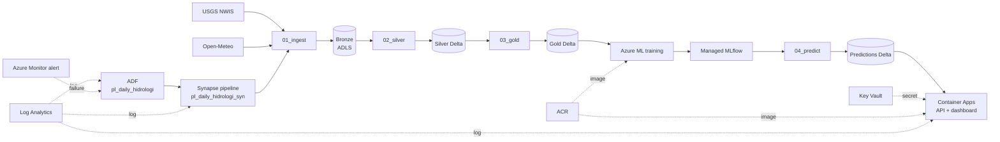

# Arsitektur Azure

Alur:

1. ADF memicu Synapse pipeline dan memeriksa statusnya.
2. `01_ingest` mengambil USGS dan Open-Meteo, menulis bronze.
3. `02_silver` membersihkan, DQ, quarantine, menulis silver Delta.
4. `03_gold` membentuk hourly, fitur, target, dataset version.
5. Azure ML melatih 9 model LightGBM, mencatat metrik dan model ke MLflow.
6. `04_predict` memuat model terbaru dan menulis predictions Delta.
7. Container Apps menyajikan API dan dashboard.

Jalur data berjalan di layanan Azure.

## Identity

- Synapse MI: storage, Key Vault, Azure ML.
- Azure ML MI: storage dan ACR.
- ADF MI: storage, Synapse, Azure ML, Key Vault.
- Container Apps: user-assigned `id-hidrologi-acr` untuk AcrPull, system-assigned
  untuk gold, Key Vault, Azure ML.
- GitHub Actions: OIDC.
