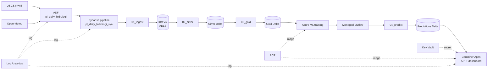

# System flow - Azure hydrology

Dokumen ini menjelaskan alur end-to-end, dari sumber data sampai serving.
Status saat ini: artefak sudah deploy, tetapi data dan model belum dijalankan.

## Diagram



## Tahap

| Tahap | Input | Proses | Output | Compute | Cara cek |
|---|---|---|---|---|---|
| Sumber | USGS dan Open-Meteo | HTTP request | JSON mentah | Synapse driver | `01_ingest` |
| Bronze | JSON sumber | Tulis per `ingest_date` | `abfss://bronze@...` | Synapse Spark | Container `bronze` |
| Silver | Bronze JSON | Schema, dedup, DQ, quarantine | Delta `silver/delta/...` | Synapse Spark | Container `silver` |
| Gold | Silver Delta | Hourly, fitur, target | Delta `gold/delta/...` | Synapse Spark | Container `gold` |
| Training | Gold features | 9 model LightGBM | Model di MLflow | Azure ML DS3_v2 | ML Studio |
| Prediction | Gold features + model | Prediksi per horizon | Delta `gold/delta/predictions` | Synapse Spark | Container `gold` |
| Serving | Gold dan predictions | API dan dashboard | HTTP | Container Apps | URL |

## Storage

```text
bronze/
  usgs/continuous/parameter_code=00065/station_id=<site>/ingest_date=YYYY-MM-DD/
  usgs/continuous/parameter_code=00060/station_id=<site>/ingest_date=YYYY-MM-DD/
  usgs/daily/parameter_code=00060/station_id=<site>/ingest_date=YYYY-MM-DD/
  open-meteo/station_id=<site>/ingest_date=YYYY-MM-DD/

silver/
  delta/usgs/continuous/parameter_code=00065/
  delta/usgs/continuous/parameter_code=00060/
  delta/usgs/daily/parameter_code=00060/
  delta/open-meteo/
  _dq/
  _quarantine/

gold/
  delta/station_hourly/
  delta/features/
  delta/dataset_versions/
  delta/predictions/
  _dq/
```

Delta silver dipartisi `station_id` dan `ingest_month`. Delta gold dipartisi
`station_id` dan `date_utc`.

## Notebook

| Notebook | Fungsi | Output |
|---|---|---|
| `01_ingest` | Ambil USGS dan Open-Meteo | Bronze JSON |
| `02_silver` | Bersihkan, DQ, quarantine | Silver Delta |
| `03_gold` | Hourly, 48 fitur, target h+1/6/24 | Gold Delta |
| `04_predict` | Load model MLflow, prediksi | Predictions Delta |

Parameter cell di notebook adalah default. Saat dipanggil pipeline, parameter
dari pipeline menimpa default. Code cell tidak meng-assign ulang default.

## Orkestrasi

```text
ADF pl_daily_hidrologi
  start_synapse
  set_run_id
  wait_for_synapse (Until + status)
  fail_if_not_success
        |
        v
Synapse pl_daily_hidrologi_syn
  ingest_bronze -> transform_silver -> build_gold -> predict
```

- ADF memeriksa status Synapse setiap 60 detik.
- Retry dan timeout ada di activity.
- Trigger `tr_daily_0600_wib` berstatus `Stopped`.
- ADF activity notebook langsung tidak dipakai karena referensi notebook
  ditolak. Fallback Web Activity yang dipakai.

## Training

- Azure ML command job.
- Environment `hydrology-training:v1`.
- Image `acrhidrogkiq7v7oc3lns.azurecr.io/training:v1`.
- Input gold lewat datastore `adls_gold`.
- 9 model: 3 stasiun x 3 horizon.
- Metrik: MAE, RMSE, bias, NSE, KGE, POD, FAR, CSI.
- Model registry: `hydrology-<site>-h<horizon>`.
- Job belum pernah disubmit.

## Serving

- API `ca-api-hidrologi`, min 0, max 2.
- Dashboard `ca-dash-hidrologi`, min 0, max 1.
- ACR pull memakai user-assigned identity `id-hidrologi-acr`.
- API `/health` 200, `/stations` 200, `/predict` 503 karena model belum ada.
- Dashboard 200, masih empty state.
- API dan dashboard belum membaca predictions untuk ditampilkan.

## Identity

| Dari | Ke | Mekanisme |
|---|---|---|
| Synapse MI | ADLS | Storage Blob Data Contributor |
| Synapse MI | Key Vault | Key Vault Secrets User |
| Synapse MI | Azure ML | AzureML Data Scientist |
| Azure ML MI | ADLS | Storage Blob Data Contributor |
| Azure ML MI | ACR | AcrPull |
| ADF MI | ADLS | Storage Blob Data Contributor |
| ADF MI | Synapse | Contributor + Synapse Administrator |
| ADF MI | Azure ML | AzureML Data Scientist |
| ADF MI | Key Vault | Key Vault Secrets User |
| API MI | gold | Storage Blob Data Reader |
| API MI | Key Vault | Key Vault Secrets User |
| API MI | Azure ML | AzureML Data Scientist |
| Dashboard MI | gold | Storage Blob Data Reader |
| Dashboard MI | Key Vault | Key Vault Secrets User |
| Dashboard MI | Azure ML | AzureML Data Scientist |
| `id-hidrologi-acr` | ACR | AcrPull |
| OIDC SP | Resource group | Contributor |
| OIDC SP | ACR | AcrPush |

## Parameter

| Parameter | Default | Dipakai |
|---|---|---|
| `window_start` | `2015-10-01` | Ingest, silver, gold |
| `window_end` | `2015-10-31` | Ingest, silver, gold |
| `predict_days` | `7` | Prediction |
| `TRAIN_MIN_ROWS` | `5000` | Training |
| `TRAIN_INCLUDE_PARTIAL` | `false` | Training |

## Kegagalan

- ADF activity retry 2x.
- Synapse notebook activity retry 2x.
- ADF Until loop gagal jika status Synapse `Failed` atau `Cancelled`.
- `fail_if_not_success` menandai pipeline gagal.
- Metric alert `alert-adf-pipeline-failed` memantau `PipelineFailedRuns`.
- Diagnostic settings ADF dan Synapse mengirim log ke `log-hidrologi-v0`.

## Verifikasi tanpa run

- Trigger ADF `Stopped`.
- ADF run `0`.
- Azure ML job `0`.
- Compute `0/2`.
- Container Apps min 0.
- Bronze, silver, gold kosong.
- Model registry kosong.

## Uji minimal nanti

- Window 15 hari, misalnya `2015-10-01` sampai `2015-10-15`.
- Data pipeline sekitar 25 sampai 35 menit.
- Training smoke dengan `TRAIN_MIN_ROWS=100` dan sample dates.
- Prediction `predict_days=1`.
- Total sekitar 60 sampai 85 menit dan $1,50 sampai $2,00.
- Metrik smoke bukan hasil penelitian.

## Gap

- ADF activity notebook langsung belum berhasil.
- API dan dashboard belum menampilkan predictions.
- Belum ada private endpoint.
- Belum ada autentikasi pengguna.
- Backfill belum dijalankan.
